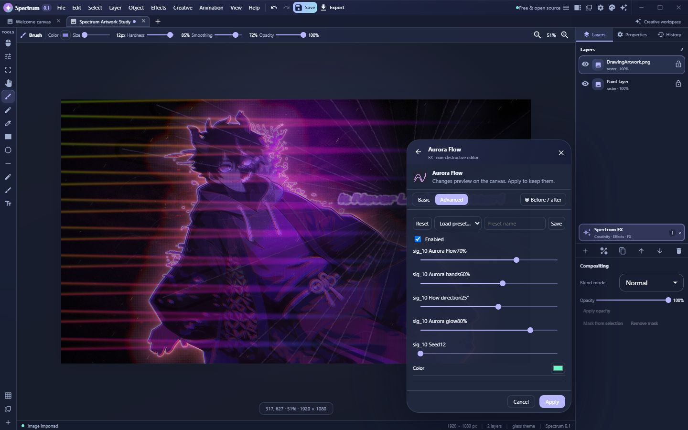

# Spectrum

**A free, open-source editor for raster and vector artwork, typography, and frame animation.**

Version 0.1.0 · Early public alpha

Spectrum is a desktop creative editor built with Tauri, React, TypeScript, and Rust. It brings image editing, editable vector and text layers, visual effects, and frame-based animation into one workspace.

> Spectrum is in early public alpha. Workflows are still evolving, and bugs or performance limits are expected.

## What you can do

- **Edit raster artwork:** import images, paint or erase on raster layers, and adjust layer visibility, opacity, order, and blend mode.
- **Build vector artwork:** create and transform shapes and paths, and edit Bézier nodes.
- **Set type:** add editable text with font, weight, alignment, decoration, background, and shadow controls.
- **Apply effects:** use image filters, layer effects, and signature FX with adjustable settings.
- **Animate frames:** work in a frame timeline with playback, scrubbing, reordering, and onion-skin controls.

## Spectrum Studio

Spectrum Studio groups its tools into **Creativity**, **Effects**, and **FX**. The library includes image adjustments and stylized filters, layer effects such as outlines, glows, shadows, and backdrops, plus signature effects such as Aurora Flow and Neon Pulse.

The Studio editor provides adjustable effect controls and before/after comparison. Applied effects remain in the layer’s effect stack for further editing.

Background removal uses heuristic image processing for connected, relatively uniform backgrounds; it is not machine-learning subject segmentation. Complex images may need manual cleanup.

## Typography

Text is stored as editable vector content. Focus Text provides a dedicated editing surface for type and paragraph controls, decorations, backgrounds, shadows, and transformations.

## Animation

Animation documents use a frame timeline with playback controls, frame durations, FPS, scrubbing, frame reordering, and onion skinning. The screenshot shows artwork on the active frame with three frame thumbnails below.

Animation export supports animated PNG (APNG), a PNG sprite sheet, or a ZIP of PNG frames. Current export limits are 300 frames and 120 million total frame pixels per export.

## Projects and formats

Spectrum saves editable documents in its versioned `.spectrum` project format. It can import PNG, JPEG, WebP, GIF, and BMP images. Image export supports PNG, JPEG, and WebP; SVG export preserves vector shapes and embeds raster image content. Raster effects are not converted into editable SVG effects.

## Native processing

The Tauri desktop backend offers CPU processing and optional GPU acceleration for a limited set of native operations: brightness, contrast, saturation, grayscale, invert, and blur. This does not mean the full filter and FX library runs on the GPU. The performance settings expose backend selection, CPU thread options, and diagnostics.

## Run from source

Install Node.js and npm, then run the browser-based editor:

~~~sh
npm install
npm run dev
~~~

Vite prints the local URL. To launch the Tauri desktop app in a configured native development environment:

~~~sh
npm run desktop:dev
~~~

Useful project checks:

~~~sh
npm run check
npm test
npm run build
~~~

## Contributing

Bug reports and pull requests are welcome. Include clear reproduction steps when reporting a problem.

## License

Spectrum is distributed under the GNU General Public License, version 3. See [LICENSE](LICENSE).
