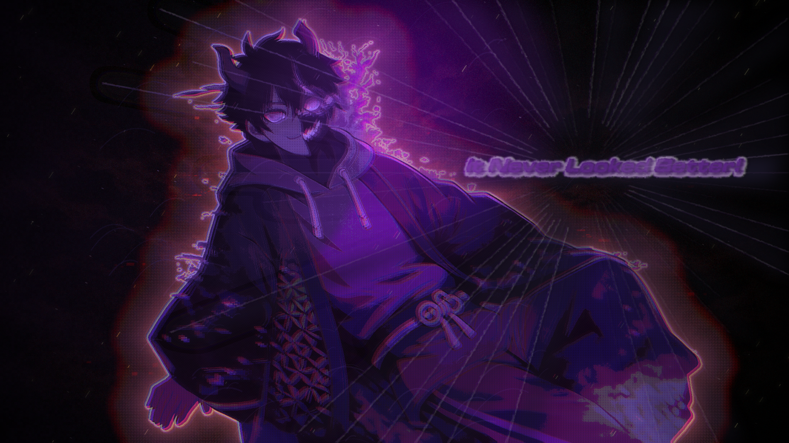
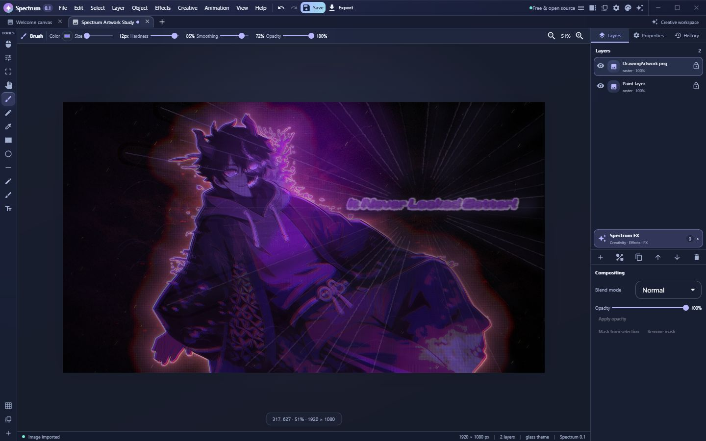
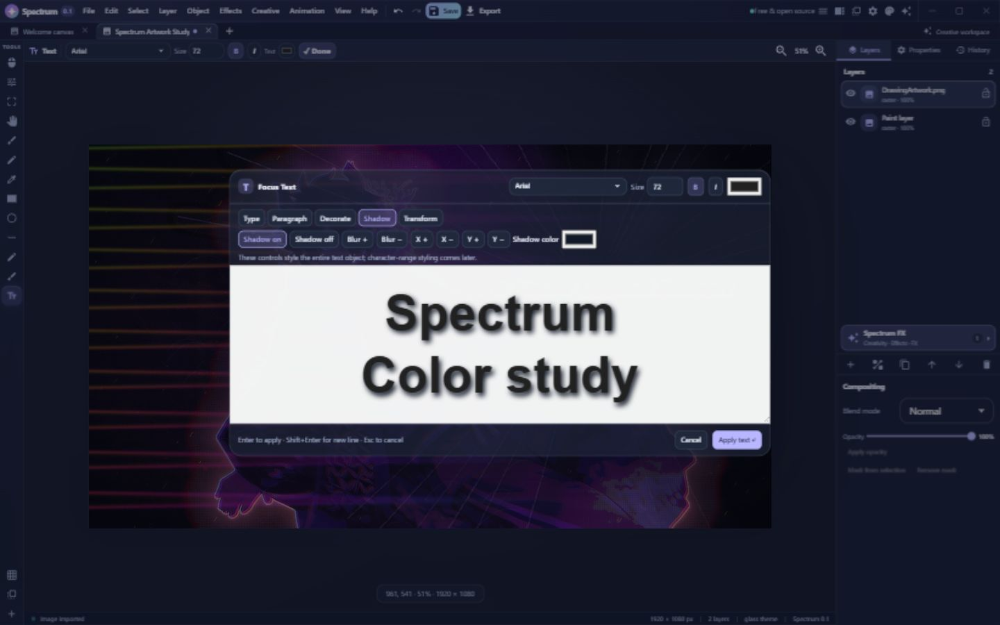
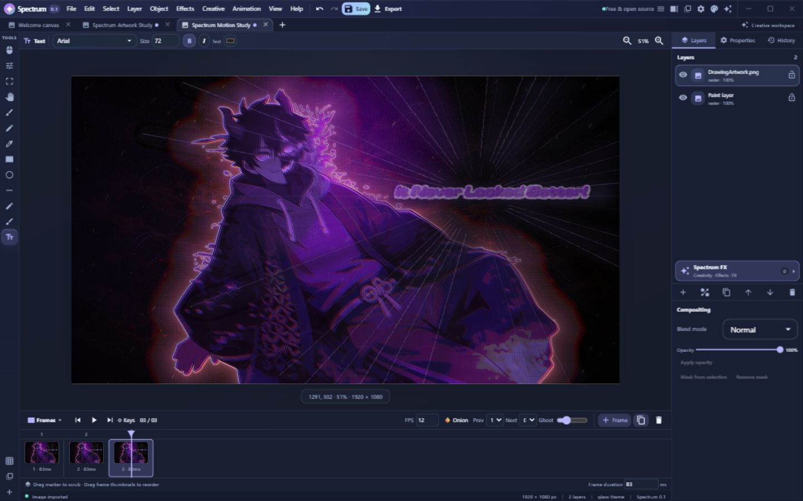

# 🌈 Huelith

[Watch the YouTube demo](https://www.youtube.com/watch?v=NJN9pCHdxZ4)

Huelith is my free and open-source image editor. I’m building it to bring visual effects and creative tools to image editing, and to make it usable on both CPU-only systems and machines with a compatible GPU.

I’ve always believed people should be able to explore their creativity without worrying about subscriptions or cancellation fees. AI-assisted edits can be useful, but generated results can still have visible artifacts. I want Huelith to make it easier to create a YouTube thumbnail, edit a selfie, or make an image your own.

I also included an Animation Studio for frame-by-frame projects alongside the image editor. I first implemented animation by accident, then decided to keep it.

**Have fun using my app!**

## What you can do

- Edit raster artwork with brush and eraser tools, image imports, and adjustable layers.
- Create and transform vector shapes and paths, and edit Bézier nodes.
- Add editable text with font, alignment, decoration, background, and shadow controls.
- Work with image filters, layer effects, and signature FX.
- Build frame-by-frame animations with a timeline and onion-skin controls.

## Shape Studio, gradients and painting (Phases W–Y)

- Click the **Shapes** button to choose among rectangles, ellipses, polygons, stars, speech bubbles, crescents, diamonds, crosses, and other editable vector shapes.
- Use the **Pencil** for crisp pixel-based painting; the **Eraser** has a recognizable icon. Mirror painting horizontally with the contextual checkbox.
- Select the overlapping **foreground/background squares** in the left toolbar to open Huelith's color picker. Set hue and saturation/value, enter HEX or RGB values, adjust opacity, and save frequently used palette colors. Press **X** to swap the two colors or **D** to reset them.
- The **Gradient** tool supports linear, radial, angular, reflected, diamond, spiral, freeform and four-corner mesh gradients. Click and drag across the canvas to create a full-canvas, editable gradient layer. Drag its on-canvas endpoints to change direction; use the compact top toolbar for colors and stops, and **Transform** for procedural map transformations. Older gradient transform settings remain readable.
- Freehand vector paths have editable anchor nodes, including those drawn with smoothing off. Use the Node tool, double-click a path segment to add a point and choose Corner, Smooth or Symmetric node handling.

## Recent editor refinements

- **Gradient Designer (Phase AK)** replaces the old modal studio: direct drawing, endpoint handles, a compact context strip, and categorized procedural transformations. Gradient layers remain editable and non-destructive.
- **Remove Background** now opens Huelith Cutout through **Inspector**. Draw exactly what stays using a brush, lasso or shape; process an editable non-destructive mask. The old color-key effect is no longer available for new work.
- All **15 Huelith Originals** have rendered tool previews and individual quick-look styles; the compact inspector has more space for tool-specific controls.
- Each theme now changes more than accent colors: panel materials, toolbar and header patterns, interaction radii and subtle depth are distinct.

## Recent editing improvements (Implementation 3)

- **Gradient** is its own left-toolbar tool, separate from the Shape Studio picker. Foreground/background squares and swap/reset buttons have clearer spacing.
- **Focus Text** now has editable style presets, starter headline/caption/poster styles, and controls for rotating or widening selected text.
- **Huelith Originals** now offers fifteen creative tools. The five additions are Particle Garden, Warp Cage, Light Trails, Pattern Architect, and Gradient Reactor. They have independent processors; Light Trails has editable path points. Originals have local presets and reset controls.
- **Layers** can be grouped/ungrouped, clipped to the alpha of the layer beneath, or supplemented with non-destructive adjustment layers that apply editable color effects to the composition beneath them.
- **Remove Background** is the model-free **Inspector → Huelith Cutout** selection workspace; no automatic subject segmentation is offered in the current interface.

## Huelith Gradient Designer · Phase AK

Choose **Gradient** on the left toolbar, then **drag directly across the canvas**. The drag establishes start and end positions for a full-canvas editable gradient. Drag either endpoint to reposition it. The top contextual strip contains eight gradient types, colors, a stop editor, Reverse, Reset, and a dedicated **Gradient Atelier** with 26 specialized recipes (27 including Unmodified). Available transformations include Starburst, Speed Rays, Twirl, Wave, Zigzag, Ripple, Pinwheel, Turbulence, Kaleidoscope, Mirror Tiles, Light Beams, Aurora Curtains, Crystal Bloom and Celestial Weave. You can adjust intensity, frequency, element count, phase, seed, and center; save your own presets. All of this is procedural and model-free, with exact native-resolution final rendering.

**New — editable ink and comic sunbursts:** Open **Transform in Atelier → Patterns → Black & White Burst** for true black/white alternating rays like a print-ready comic burst (not a blurred two-color ramp). Change ray pairs, width, center, rotation, twist, taper and edge softness; choose Smooth, Hard stops, Bands, Alternating, Stepped or Pattern palette. Multiple stops can create multicolored hard-edge rays. The result remains a native Gradient layer, reopens with its controls intact, and exports at document resolution. See `docs/HUELITH_AM1_GRADIENT_PATTERNS.md`.

The former Gradient Studio dialog has been retired. Older gradient files (including Sunburst and Anime Speed Lines) remain supported. There is no claim of guaranteed 60 FPS for CPU-intensive, native-resolution transforms.

## Implementation 5: faster caching, animation and release checks

- **Performance:** Economy, Balanced and Responsive worker budgets now also control retained raster-source memory. Existing optional GPU acceleration and CPU rendering remain available; expensive effects can still take much longer than a frame to process.
- **Animation:** More accurate elapsed-time playback, 0.25×–2× preview speed, keyboard timeline navigation, and Linear/Hold/Ease In/Out animation-key interpolation for Huelith Originals.
- **Workspace:** Optional rulers and 10px geometric snapping with Alt override, independent of the grid overlay.
- **Release checks:** `npm run release:source` performs offline source tests and syntax checks. On a fully configured Node/Rust computer, `npm run release:check` additionally type-checks, builds Vite, and checks Rust. Source checks do not substitute for an installed Windows release test.

## Remove Background — Huelith Cutout (Inspector)

Select a raster image and open **Inspector → Remove Background**. The dedicated
**Huelith Cutout** workspace lets you mark **exactly what must remain visible**.
No models, segmentation guesses, background-color thresholds, or online services
are used in the new workflow.

- **Keep brush** paints selected areas of the subject.
- **Freehand lasso**, **polygon lasso**, **line**, **rectangle** and **ellipse** quickly create selections.
- **Remove brush** subtracts from the selected region; **Eraser** clears selection markings.
- **Pan** and **Zoom** let you work on fine details.
- **Original**, **Mask** and **Preview** views show what you've selected and the eventual transparency.
- **Feather**, **Expand/Contract** and **Smooth** refine the mask boundary.
- **Undo/Redo**, **Reset selection**, **Cancel** and **Process mask** complete the workflow.

**Process mask** stores a native-resolution editable PNG alpha mask on the
selected raster layer. The original RGB image is never erased. Toggle, reopen,
or delete its mask from Inspector. The mask is rendered in the editor and in PNG,
WebP and SVG export. Old projects using the former *Remove Background* Effect
remain readable, but that legacy Effect can no longer be newly added from Huelith Studio.

**Selection is manual and predictable.** Selecting a character with intricate
edges still requires tracing or painting it; Cutout does not identify characters
automatically. For complex artwork, start with a lasso and refine small details
with the brush.

## Effects and filters

The editor groups its image tools into **Creativity**, **Effects**, and **FX**. Creativity contains image adjustments and stylized filters. Effects includes layer tools such as outlines, glows, shadows, and backdrops. The FX library includes options such as Aurora Flow and Neon Pulse.

Effect controls vary by tool. The FX editor can preview changes before applying them and keeps applied FX in the layer’s editable effect stack.

Background removal is now an Inspector operation, separate from the Effects stack. Legacy cutout effects remain loadable only for older projects.

## Text and vector artwork

Text is stored as editable vector content. Focus Text provides a dedicated editing surface with type, paragraph, decoration, background, shadow, and transform controls.

## Persistent animation-layer effects (Phase AI)

Apply any Creativity filter, layer Effect or signature FX **once** to an animation layer. Its effect stack—order, amounts, colors, enabled state, and settings—now belongs to that layer across every animation frame. Frame drawings remain independent. Scrubbing, playback, thumbnails and PNG/APNG/frame-sequence export use the same layer stack; an effect removed from the layer cannot reappear because another frame still contains an old copy. This is **not** effect-per-frame editing or effect-keyframe animation. Legacy `.spectrum` and `.huelith` animation files remain readable.

**Release inventories:** [Spectrum v0.1-alpha](docs/changelog/v0.1-alpha.md) · [Huelith v0.2-alpha](docs/changelog/v0.2-alpha.md)

## Animation Studio

The frame timeline includes playback, FPS and frame-duration controls, scrubbing, frame reordering, blank and duplicate frames, and onion skinning.

Animation export supports animated PNG (APNG), a PNG sprite sheet, or a ZIP of PNG frames. Exports are currently limited to 300 frames and 120 million total frame pixels.

## Project files and export

Huelith saves editable documents in its versioned `.huelith` project format. It can import PNG, JPEG, WebP, GIF, and BMP images, and export PNG, JPEG, WebP, and SVG. SVG export preserves vector shapes and embeds raster image content; effects are not represented as editable SVG effects.

## CPU and GPU processing

The native Tauri backend offers CPU processing and optional GPU acceleration for a limited set of operations: brightness, contrast, saturation, grayscale, invert, and blur. The wider filter and FX library does not run through this GPU backend. Performance settings include backend selection, CPU-thread options, and diagnostics.

## Run from source

Install Node.js and npm, then start the browser-based editor:

~~~sh
npm install
npm run dev
~~~

Vite prints the local URL. To run the Tauri desktop app in a configured native development environment:

~~~sh
npm run desktop:dev
~~~

For a type check, test run, and production build:

~~~sh
npm run check
npm test
npm run build
~~~

## Project status

Huelith is in early public alpha. Features and performance are still evolving, and bugs or unfinished workflows are expected.

If you notice something wrong, please post it in [Issues](https://github.com/Mimix231/Huelith/issues). Reports and observations are helpful.

## License

Huelith is distributed under the GNU General Public License, version 3. See [LICENSE](LICENSE).

### Phase AL workspaces (0.2 alpha)
- **Gradient tool → Gradient layer → Transform in Atelier** opens an art-directed workspace with 26 editable procedural transforms and a stack.
- **Inspector → Remove Background** opens a non-AI Cutout workspace with Ctrl+wheel zoom, Space/middle-mouse pan, undo/redo, larger brushes and smooth masks.
- Animation rendering keeps layer FX visible during playback and reuses memory-bounded exact processed frames; heavy first passes can still stutter.
- Main-canvas snapping also covers object movement and Gradient handles.
- See [Phase AL details](docs/HUELITH_PHASE_AL_WORKSPACES.md).

### Core editing operations (Huelith 0.2 development)
- **Edit → Resize Image / Resize Canvas:** choose dimensions and resampling or a nine-point canvas anchor.
- **Edit → Crop to Selection / Trim Transparent Pixels:** quickly trim document bounds.
- **Edit → Rotate / Flip:** transform artwork geometry, raster pixels and associated masks.
- **Edit → Precision Transform (Ctrl+T):** enter precise position, dimensions, and rotation.
- **Edit → Fill/Stroke/Clear Selection:** edit the current raster cel with the active foreground color and brush width.
- **Layer → Rasterize / Align / Fit to Canvas:** common layer editing actions without a separate studio.
- **Right-click canvas** for Huelith's custom command menu. Drag with Move for magnetic canvas-edge, midpoint, and **center-cross (+)** alignment guides. Hold Alt to temporarily bypass snapping.

For architecture, tests and limitations, see [Core Editing Actions & Magnetic Canvas Snapping](docs/HUELITH_CORE_ACTIONS_AND_MAGNETIC_SNAPPING.md).

### Smart Transform & Gradient Atelier (Order 2)
Use **Move** to scale/rotate selected artwork with cyan guides and a draggable transform pivot. Drag corners to scale proportionally; hold **Shift** for free resizing, or **Alt** to bypass snapping. Snapping to canvas center forms a visible + guide. Double-click the transform dimensions or press **Ctrl+T** for exact numeric edits. Gradient Atelier's Color Bands and procedural field transformations work with patterned Gradient layers. See [Order 2 notes](docs/HUELITH_AM2_SMART_TRANSFORM.md).

### Magnetic transforms and canvas-only editing
Press **Ctrl+T** to select the entire active layer and reveal on-canvas scaling and rotation handles. Drag corners to resize proportionally, hold **Shift** to resize freely, or hold **Alt** to temporarily disable magnetic snapping. Canvas borders, centers, and nearby objects produce cyan guides when an image snaps into alignment. Magnetic snapping is enabled by default; the toolbar icon turns it on or off. **Ctrl+Alt+T** opens the optional numeric Precision Transform editor.

Selection, drawing, and new layer moves begin only within the document canvas. Middle-mouse and Hand-tool panning remain possible in the surrounding workspace.

### Brush Atelier & continuous line art (v0.2-alpha)
Choose **Ink Pen** from the left toolbar for a continuous filled-contour stroke instead of stamped brush-tip circles. For softer paint, use **Brush**. Click **✦ Brush Atelier** in the top context toolbar to switch engines, tune brush width (1–2000 px), stabilization, flow, spacing, pressure response, opacity and taper, or load/save presets. Available starter presets: Smooth Ink, Comic Line, Fine Liner, Soft Paint, Round Brush and Marker. Pen tablets use native pointer pressure; mouse strokes use full pressure. Symmetry, selections, masks and animation-cel painting remain supported. Each finished stroke is one undoable operation.

### Painting, selection and retouch
The **Selection Studio** tool picker adds Magic Wand, Freehand Lasso, Polygon Selection and Magnetic Lasso. Freehand and magnetic paths form real pixel-selection masks; the Paint Bucket respects the active selection and offers configurable color tolerance. Double-click or press Enter to complete a polygon selection. The **Painting & Retouch** picker provides Paint Bucket, Smudge, Blur Brush, Sharpen Brush, Dodge, Burn, Pattern Brush and Symmetry Brush. Pattern Brush offers stars, dots and hatches. Processing stays local; no AI models are required.

### Editable Huelith Cutout shapes
Select **Edit mask shapes (◇)** inside Cutout to pick and move committed strokes and shapes. Rectangle and Ellipse have four corner grips; line endpoints and polygon/lasso nodes are editable. Double-click on a segment to insert a vertex. Delete the selected point or shape, nudge with arrow keys, and adjust the selected mask shape's width or Keep/Remove action. Shape moves and parameter edits are undoable, and editable shape data is saved with the project while previous raster-only masks remain loadable.

See [Drawing and Cutout Editing](docs/HUELITH_DRAWING_SELECTION_CUTOUT.md) for behavior, tests and limits.

### Animation Studio — Layer Timeline & Exposures (v0.2-alpha)
The Animation Studio supports a layer-based exposure sheet in addition to its frame thumbnail timeline. Select raster/vector cels per layer, hold drawings across frames without repeating their pixel buffers, label frames, duplicate or delete selected frames, and apply shared frame durations. Shift/Ctrl-click to select multiple frames, and Alt-click or right-click a layer cel to hold/release the preceding drawing. Loop ranges, one-shot and ping-pong playback preserve variable frame durations. Persistent layer effects remain shared across every cel.

See `docs/HUELITH_ANIMATION_STUDIO_EXPOSURES.md` for workflow and known limitations.

### Meme Creator & professional workspace (Huelith 0.2-alpha)

**Edit → Create Meme** opens a Huelith-themed layout studio for creating nine kinds of memes without damaging the original artwork. Captions remain editable vector text; speech bubbles and background panels remain native shapes. Optional comparison images become separate raster layers. Drag captions inside the live preview, apply in a single undoable operation, then edit using the standard canvas tools.

**Edit → Export Meme as PNG/JPEG/WebP** uses the established native-quality export pipeline. The workspace now features consistent surface depth, theme-specific icons and palettes, a Sakura pink/pearl/purple treatment, and transform grips accessible outside the white canvas. Read `docs/HUELITH_MEME_CREATOR_AND_WORKSPACE.md` for limitations and validation.

### Find the Meme Creator

Click **Meme Creator** in the top bar or **Meme** in the left tool rail. You can also use **Creative → Open Meme Creator…**, **Edit → Create Meme…**, or **Ctrl+Alt+M**. All routes open the same non-destructive workspace. On narrow screens, the header launcher collapses to an icon; its tooltip still says **Meme Creator**.

### Expanded Creativity library (v0.2-alpha)
Huelith Studio includes **120 additional locally processed, non-destructive image operations** in eight Creativity families: Color Science, Lighting & Atmosphere, Artistic Painting, Distortion & Geometry, Anime & Comics, Materials & Surfaces, Digital & Experimental, and Cinematic & Optical. Use the horizontal category selector, search across all families, or favorite an operation to find it later. Each operation has its own Canvas2D processing rule and vector icon. Results remain editable on the layer and use the same render pipeline for preview and export.

The Gaussian, Box, Motion, Radial, Lens, and Surface blur paths have additional luminance/alpha normalization. Tests verify that flat opaque images do not become brighter or transparent under blur stacks. Complex effects may still take longer to render on CPU-only machines.

**Meme Creator is opened only from the prominent top title-bar button or Edit → Create Meme.**

### Creativity App Hub & Responsive Studio
The **Creativity** tab now opens Huelith's app hub. Open Chromatica, Luminara, Detailworks, Paintoria, Manga Lab, Warpworks, Signalworks and other focused apps to see their associated creative filters and styles. **Back to apps** returns to the hub; Effects and Signature FX are also available as apps or direct tabs. The catalog uses lightweight hand-designed effect icons instead of eagerly rendering all 120 pixel thumbnails. The exact artwork preview still uses the original full-resolution effects pipeline. The dedicated worker renders expanded effects with cancellable scanline scheduling. Unsupported WebView2 versions display a renderer warning instead of freezing the main canvas. See [Studio app hub and rendering notes](docs/HUELITH_CREATIVITY_APP_HUB_AND_FREEZE_FIX.md).
