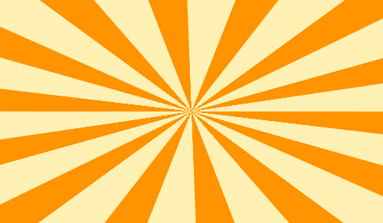
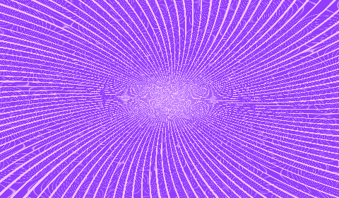

# Huelith 0.2.0 — Implementation 4: Phases AC, AD and AE

**Canonical source:** the user-supplied `c8d625c1-115e-421c-8427-4b72d8ad5ba5.zip`; previous assistant archives were not used as the starting point. This development build does not change Huelith's version or rename effect identities.

## UI and Gradient Studio corrections

- Foreground/background squares and their swap/reset controls now fit within the canonical 35px left tool rail; previously the 40–44px controls overflowed the available width.
- **Gradient tool opens Gradient Studio immediately** instead of requiring another button in the redundant top context strip. Selecting the same tool again reopens it. The gradient context strip has been removed while that tool is active.
- Existing full Gradient Studio UI, eight gradient families, skew/scale/wave/color stop editing and all other canonical changes remain.
- Added a **Pattern toy box** with smooth gradients, Sunburst / Twisted Rays, and Anime Speed Lines. A 14-ray two-color orange poster burst and a 115-ray violet action-line starting point are included. Color stops remain editable, as do ray count, band width, edge softness, taper, luminous fibers, variation seed, angular distortion/twist, center, rotation, zoom and color phase. Results are persisted as non-destructive vector-gradient properties and can be exported.
- Reference output generated from the **actual gradient CPU renderer**, not simulated screenshots:

## Phase AC — Color and Light

- Kept the canonical 24 registered Color & Light operations. Existing Curves already includes an editable graph; Gradient Map and Duotone use editable multicolor ramps; Levels already supports actual tonal mapping.
- Added a real, logarithmically scaled luminance histogram to the Levels advanced editor. It samples source raster pixels rather than displaying a decorative placeholder. For vector layers, the editor explains why a raster histogram is not available.
- Fixed **Selective Color at 0%** still altering source pixels. It now fades correctly from no adjustment to the selected color-preservation behavior. Exposure keeps its distinct linear-light EV calculation rather than mimicking Brightness.

## Phase AD — Detail and Stylize

- Preserved all 21 Detail & Texture entries, all 32 Stylize entries and their existing independent processing modules.
- Reworked **Clarity** to focus midtone local contrast, and **Texture** to respond to high-frequency material detail with edge protection; both now have meaningfully different tone weighting.
- Made **Sharpen** and **Unsharp Mask** independent in their amplification behavior, keeping the latter's thresholded blurred-reference subtraction.
- Improved **Surface Blur** edge gating so prominent silhouettes survive color smoothing. Kept the original distinct Shock Zoom, Motion/Radial/Lens Blur, Oil Painting/Watercolor and style processors.

## Phase AE — Effects and signature FX

- Fixed a **Glow-on-opaque-artwork bug**: alpha silhouettes are not useful when a pasted image is fully opaque. Added edge-driven luminosity extraction for opaque photographs while retaining the existing silhouette-distance glow for transparent layers. The original source stays in place; Bloom retains its highlight-based code path.
- Removed the **hardcoded 64-effect cap** in the Studio UI, preview controller, append operations and document validation. This does *not* make many full-resolution effects free; large stacks need performance/memory testing.
- Retained all seven major layer effects, 22 independently dispatched signature FX and 101 effect-catalog entries. Regenerated the outdated engine inventory and corrected the obsolete `25 Stylize/15 FX` count to `32 Stylize/22 FX`.

## Validation performed

- Node regression suite: **219/219 passed**, including six new implementation-4 tests.
- Chromium focused fidelity regression: **20 effect kinds tested** for parameter progression, plus sample Alpha/Color behavior, Selective Color 0% identity and real sunburst/speed-line sampling. All tested kinds respond to parameter changes.
- Existing seven-layer Effects tests: **24 passed**; existing newest-FX tests: **98 passed**.
- TypeScript syntax parser: **69 TS/TSX files passed**.
- `scripts/audit-effects.mjs`: **101 catalog entries, 22 signature FX**.
- The actual production TypeScript check was **attempted but blocked** by missing npm type dependencies (`react`, `react-dom`, Babel typings etc.); `npm ci` failed with npm's `Exit handler never called` error in this environment. No full Vite/Tauri/Rust build or installed-Windows UI test is certified.

## Still open before 0.3 / 1.0

- Not all 101 catalog entries have undergone independent artist-reviewed visual acceptance, particularly complex painterly styles. The 20-kind smoke test is a **sample**, not a certificate for the entire catalog.
- Full installed-app acceptance, GPU/CPU parity, 1080p and 4K frame-time profiling, and exact preview/export parity on deeply nested stacks are still required.
- Complex-image Remove Background remains heuristic and may need manual Keep/Remove corrections; this implementation does not add semantic AI subject segmentation.
- The Pattern toy box's 4K per-parameter render can be CPU-expensive; no 60 FPS claim is made.
- Advanced FX still uses its existing independent visual models; no previously named effects have been replaced with generic approximations.
